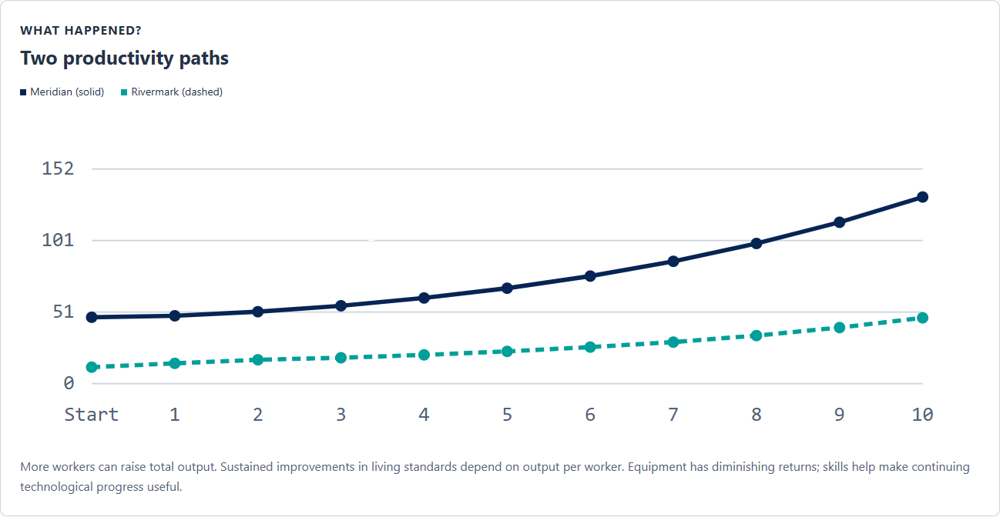

# Rival Cities

*A city-building game about productivity and economic growth.*

Use Rival Cities to introduce the inputs behind a production function through investment decisions. This guide connects the ten-round development race to productivity, diminishing returns, complementary inputs, and the catch-up effect, then suggests ways to use the ending as evidence for discussion.

## Why This Game Exists

I finally got around to the topic of productivity and growth, and I needed a game that would suit it. Having played several resource-building games, I knew that format was perfect for Rival Cities. Once I had determined the format, I thought it was important for this game to behave more like the resource-building games students might recognize. That meant including character guides and rivals to create a sense of competition.

I also decided to focus the game on the factors of production. The player can improve education, capital, resources, or research. Consequently, students are working with a production function without seeing the math behind it.

While you are building your own city with the scarce resources provided, you also get to see how another city is being built. The key is that you are watching the catch-up effect take place, perhaps without even realizing it. The ending of Rival Cities explains the economics.

## What Students Do

Students are assigned either Meridian, an established economy with substantial capital and advanced technology, or Rivermark, a smaller economy with room to catch up. Ellis, their city advisor, introduces investment and offers guidance as conditions change. Each of ten rounds provides 20 development points to distribute among Industry & Infrastructure, Food, Water & Resources, Research & Innovation, and Schools & Training. Students can adjust the allocation before committing all 20 points.

The city develops after each commitment, and feedback connects the plan to changes in production and productivity. The rival appears in Round 3, having developed throughout the opening rounds. Students can then inspect both cities, review the rival’s past investments, and reconsider their priorities. The computer manages the other city through its own development strategy; it does not react to the player’s uncommitted plan.

Meridian’s challenge is to maintain its lead while continuing to improve. Rivermark’s is to close the productivity gap. After Round 10, students receive a comparative report, explanations of their investment path, and a four-question concept check. Replay assigns a city again and changes the rival strategy. The run stays in the current tab; reloading starts over.

## What the Game Is Really Teaching

### Production and productivity

The four investment categories make a production function tangible. Industry & Infrastructure adds physical capital. Schools & Training builds human capital. Food, Water & Resources supports production and the workforce. Research & Innovation develops better methods and helps a city adopt existing technology. Labor grows within the simulation rather than through a separate hiring choice. Students are deciding which inputs need support and seeing how their combination affects output.

Keep total output separate from output per worker. A larger workforce can produce more without an improvement in productivity. Output per worker asks how much each worker produces and is the central measure in the race. It connects the activity to long-run living standards, although the game does not measure every aspect of well-being. Development points represent a limited investment budget, not dollars of GDP.

### Starting conditions and diminishing returns

Meridian begins with far more equipment per worker than Rivermark. Additional equipment can therefore have a larger marginal payoff in Rivermark, where capital is scarce. As capital accumulates, further additions generally produce smaller gains, holding other inputs constant. This is diminishing returns, not a claim that additional equipment must reduce output.

Rivermark also has opportunities to adopt technology already available in the region. These advantages create catch-up potential, but the investment path determines how much of that potential becomes actual growth. Meridian must find ways to improve an already productive economy. Its starting lead can survive even when its percentage growth is lower. The two starting positions make a single investment recipe an unreliable guide to development.

### Inputs that work together

Equipment needs workers who can use it, and research is more valuable when workers can adopt the resulting methods. Training can also be underused when workers lack equipment. Food, water, and utilities support both production and workforce growth. When that capacity falls behind the city’s needs, other investments deliver less than they could. These bottlenecks arise from the evolving economy; they are not a scheduled crisis in a particular round.

Extra resource capacity can relieve a shortage, but adding still more when capacity is ample has little direct productivity payoff. This makes opportunity cost concrete. A point committed to one district cannot fund another need in the same round. The useful question is which constraint an investment addresses and what the city gives up to fund it.

### Growth over time

Some training becomes effective immediately, while most completes in the next round. Research builds capacity that can continue producing improvements in later rounds. Early choices therefore change the payoff from later ones. Training still in progress at the ending has not necessarily failed; some benefits lie beyond the ten-round horizon. Sustained productivity growth depends on improving knowledge and methods alongside supporting inputs as further capital accumulation faces diminishing returns.

## Reading the Final Report

Begin with both cities’ final output per worker, then compare their productivity growth from their own starting points. The result describes the lead, progress in closing the gap, and the player’s own improvement. A city can grow faster in percentage terms and still finish less productive. Holding a lead can also reflect an inherited advantage despite weak subsequent growth.

The report traces each city from its starting level through all ten rounds. Use the round ledger to connect a change in the path to the investments and conditions behind it. Several inputs change together, so a gain cannot automatically be attributed to the most recent investment in one district.

The relative gap uses Meridian’s output per worker as the reference. Distinguish this from the absolute difference between the two levels. The ending illustrates the distinction with an economy growing from 20 to 24 and another growing from 100 to 108. The smaller economy grows faster and closes the relative gap, even though the absolute difference rises from 80 to 84. Students can use the same reasoning to interpret their own report.

## The Educational Loop

The city-building decisions come first. Round feedback makes their consequences visible, and “The Economics Behind the Race” names the concepts in the completed report. The ending then connects the student’s investment history to growth policy and opportunity cost. Its four-question concept check addresses catch-up, diminishing returns, complementary skills and technology, and a new economy’s development opportunity. Incorrect choices receive explanations and can be retried; a correct response unlocks the next question.

**Experience → Consequence → Economic Explanation → Formalization → Transfer**

Faculty can introduce production-function notation after students explain the relationships in words. The game does not display the underlying equation. The final concept question provides built-in transfer; an instructor can extend it by changing the new economy’s constraints and asking whether the proposed investment still makes sense.

## Using It in Class

Allow roughly 15–20 minutes for an initial run and reading the ending, with additional time for discussion or replay. This is a planning estimate; students who inspect both cities closely may need longer. Individuals can play independently, or pairs can agree on an allocation and explain its opportunity cost before committing it.

Before formal growth instruction, let students build first and describe why they changed their plans. During instruction, pause after the rival reveal to compare starting conditions. Ask students to predict which investment would have the larger payoff in each city, then return to those predictions in the final report. Keep time for the ending: the race supplies the experience, while the explanations and concept check connect it to economics.

For a short assessment, ask students to identify one investment, the constraint it addressed, and evidence from the report that supports their interpretation. On replay, record the assigned city and the rival strategy as well as the allocation. Both can change, so a different ending does not by itself isolate the effect of one revised choice. Compare runs with the same player city when discussing how an investment path changed its own productivity.

## Questions to Consider

1. Which city were you assigned, and how did its starting conditions shape your first investments?
2. What did you give up when you committed more points to one district?
3. Why might the same addition to capital per worker produce different gains in Meridian and Rivermark?
4. Which bottleneck changed your plan, and what evidence suggested that it was limiting production?
5. Did either city grow faster while remaining less productive? Use its starting and ending output per worker to explain.
6. Did the relative productivity gap and the absolute difference tell the same story in your run?
7. Which investment depended on earlier choices or had benefits still unfolding at the ending?
8. In an economy with strong schools but little equipment, what would you fund next? How would a shortage of water or power change your answer?

## Common Misconceptions

- “More total output means higher productivity.” Output can rise because there are more workers; check output per worker.
- “The faster-growing city must be ahead.” Percentage growth depends on the starting base. Compare final productivity levels too.
- “A poorer economy will automatically catch up.” Low capital and access to existing technology create opportunities; supporting inputs and investment choices affect the result.
- “Diminishing returns means equipment becomes harmful.” It means a smaller marginal gain from additional capital, holding other inputs constant.
- “Research works equally well regardless of training.” Skills affect technology adoption, and equipment helps workers put those skills to use.
- “Every worthwhile investment must pay off before Round 10.” Some training remains incomplete, and research capacity can have benefits beyond the game’s horizon.
