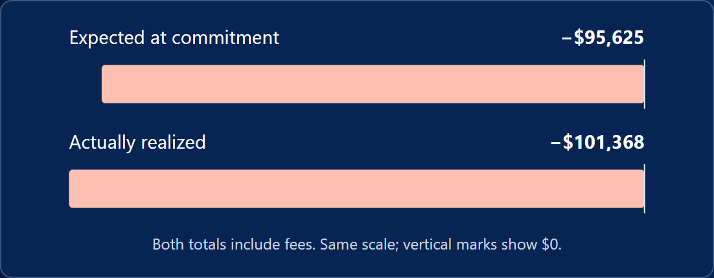

# The Investment Desk

*Capital allocation and investment decisions under uncertainty*

Use The Investment Desk to connect project selection with opportunity cost, net present value, and the value of information. Students make decisions from proposal cards before opening the calculations and reviewing how their choices performed.

## Why This Game Exists

This game came out of left field. I was reviewing material for a non-principles course and thought I could make a game for one of the more niche topics usually covered later in a principles of microeconomics text.

I then needed to get the content into a game format that would remove the math and let students focus on their choices and opportunity costs. That is where the card-style game idea hit. In classic card games, information about a character or another game attribute is listed on the card. Players use that information to determine what they want to play and how.

By placing the investment information on each card, students do not need to work through the math. We do that for them later when we show them their choice history. Instead, they can focus on maximizing the value of the firm’s investment decisions.

While building it, I noticed that the first stage was too quick, so I added uncertainty to the second stage. I wanted to show students how important information is: what appears to be a profitable venture may turn out to be unprofitable once enough information is available.

## What Students Do

Students first compare six investment proposals, inspect their costs and projected net present values, and assemble a portfolio within a limited capital budget. They can remove and replace projects before committing. The report compares their selection with a best feasible combination and explains the opportunity cost of the allocation.

The second stage provides a fresh $250,000 and five proposals with uncertain outcomes. Students can invest, reject a proposal, purchase research, or pay to hold a proposal until a market bulletin arrives. Investments and rejections are binding. Research is optional, and students can finish with several investments, one, or none. Finishing passes on all remaining open or held proposals.

Funded projects reveal their outcomes, followed by a report comparing forecasts with results, accounting for fees, and reviewing decision history. Students can revisit the earlier portfolio report, replay the same scenario, or start with new conditions. Reloading starts a fresh game; stored histories do not resume an unfinished desk.

## What the Game Is Really Teaching

### Value today and the cost of capital

Net present value, or NPV, brings future net cash flows into today’s value and subtracts the initial investment. A positive NPV represents value beyond the required return. Later cash flows are discounted more heavily, so a large advertised total return may be less attractive once timing is considered. Students can inspect the year-end cash flows and discount rate without calculating NPV themselves.

The first stage varies proposals, costs, cash-flow schedules, and the capital budget across scenarios. Its common discount rate can be 8%, 10%, or 12%; the second stage uses 10%. These are fictional instructional conditions. The discount rate represents capital’s alternative earning power. That opportunity cost is already included in NPV and should not be subtracted again as an additional expense.

### Choosing a combination

A positive-NPV project can be worth undertaking on its own yet lose out to a better use of scarce capital. The largest individual NPV need not belong in the strongest portfolio: smaller projects may fit together and create more combined value. Students must compare affordable combinations of whole projects. Borrowing and partial project funding are not available.

The first report checks all 64 possible subsets of the six proposals. Its benchmark is the greatest combined NPV within the budget, rather than the amount spent or the number of projects selected. Unused capital can be sensible when the remaining proposals are unattractive or cannot be funded in full. Keeping cash has zero incremental project NPV in this model.

### Information changes a decision

In the second stage, expected NPV weights favorable and adverse project values by their current probabilities. It describes an average of possible outcomes, not a promised return. Research changes the probabilities and may change which investments are attractive. Because projects share economic conditions, evidence from one project can also affect forecasts for others. Holding several projects does not eliminate common market risk.

Information has value when it can improve a choice enough to justify its price. Report accuracy alone does not establish that value: an accurate report may add little if either result leaves the preferred decision unchanged. The optional information-value estimate considers one project’s invest-or-reject decision before the research fee. Competition for the portfolio budget can change its usefulness; the estimate is not a complete strategy for the whole desk.

Waiting costs $2,000 per proposal and preserves the option to decide after an imperfect bulletin. Only paid holds remain available then. Research and waiting fees reduce available capital and remain paid even after rejection. Once paid, those fees are sunk; students should evaluate the remaining investment opportunity using current information rather than invest merely to justify an earlier expense.

### Covering operations and recovering investment

Fresh-food packing makes a second threshold visible. Selling 3,000 cases per year covers operating costs, but does not recover the $90,000 initial investment. The optional detail shows a zero-NPV threshold of about 4,810 cases per year over three years at the stated discount rate, before information fees. Operating breakeven and an investment that earns its required return answer different questions.

## Reading the Portfolio Reviews

In the first report, compare the student’s portfolio with the best feasible combination before opening “How does NPV work?” The worked example uses the projects actually selected, combines their annual net cash flows, discounts them at the scenario’s rate, and subtracts the initial investment. Different project lives are reflected in that schedule. The calculation explains a choice students have already made.

The final report separates expected NPV at commitment from realized NPV. Both net totals deduct research and waiting fees once. Individual project NPVs exclude those separate fees. “Capital kept” is uncommitted budget, not profit or the sum of future receipts. Expected totals combine forecasts recorded when each investment became binding, so they may reflect different information available at different times.

In this example, expected net NPV was already negative before outcomes were revealed. The player funded Fresh-food packing despite a negative updated forecast. The loss therefore warrants examining the information and choice at commitment; it cannot be explained only as bad luck. A positive forecast followed by a loss would require a different discussion.

“How did my decisions compare?” evaluates each investment against then-affordable combinations of open projects using information available at that time. It does not grade choices against later outcomes or solve every possible research-and-wait strategy. The research review compares the tentative plan, signal, and eventual choice. A changed decision may also reflect other signals or budget constraints. Passed proposals show forecasts at rejection, not their hidden realized outcomes.

## The Educational Loop

The first desk builds experience with scarcity and combinations. Its review supplies the economic explanation and a worked calculation. The second desk carries that reasoning into uncertainty, then distinguishes the quality of a choice from the outcome it happened to produce.

**Experience → Consequence → Economic Explanation → Formalization → Transfer**

Both reports offer a print-shop application through expandable prompts. These invite discussion rather than score a response. Ask students to explain how they would compare equipment or delivery investments, then decide whether a customer survey could improve that choice enough to cover its cost.

## Using It in Class

Allow roughly 15–25 minutes for both stages and their reviews, with additional time for discussion or replay. This is a planning estimate; opening every proposal and calculation will take longer. Individuals can play independently, or pairs can explain why one affordable combination offers more value than another before committing it.

Before teaching NPV calculations, have students use the displayed values and describe what makes the budget restrictive. Open the first report’s worked example afterward to connect those values to timing and the required return. During uncertainty instruction, ask students to record a tentative decision before research and explain what evidence would change it. The second report can then support discussion of information value, sunk costs, and hindsight bias.

For a short assessment, request a decision, the information available when it was made, and the alternative it displaced. Use “Replay this scenario” to change one decision while keeping the underlying scenario fixed. “Replay with new conditions” varies the first-stage proposals and second-stage conditions, signals, and outcomes; the five uncertainty-stage project identities remain the same. A changed result in a new scenario is not evidence that the revised strategy alone caused the difference.

## Questions to Consider

1. Which affordable combination did you choose, and what alternative did it displace?
2. Did the largest individual NPV belong in the best feasible portfolio? What made the combination matter?
3. Why can a project with a large total cash return have a lower NPV than another proposal?
4. When would keeping some capital uncommitted be a sensible choice?
5. What information could change your investment decision, and how would you judge whether it was worth buying?
6. After paying for research or waiting, why might rejecting the project still be the better decision?
7. Did the realized result support your original expectation? How would you evaluate the decision without using hindsight?
8. Why does covering Fresh-food packing’s operating costs require fewer sales than earning a zero NPV on the investment?

## Common Misconceptions

- “A positive-NPV project must be funded.” A better affordable combination may use the same scarce capital more effectively.
- “Spending the entire budget proves success.” Unattractive or indivisible projects can make keeping cash sensible.
- “The discount rate is an extra charge to deduct after NPV.” The calculation already accounts for capital’s opportunity cost.
- “More information guarantees a profitable outcome.” Signals are imperfect, and useful information must also justify its cost.
- “Paying for research commits me to investing.” The fee is sunk; updated evidence can justify rejecting the project.
- “A loss proves the decision was wrong.” Judge the choice against available alternatives and information at commitment; realized outcomes also reflect uncertainty.
